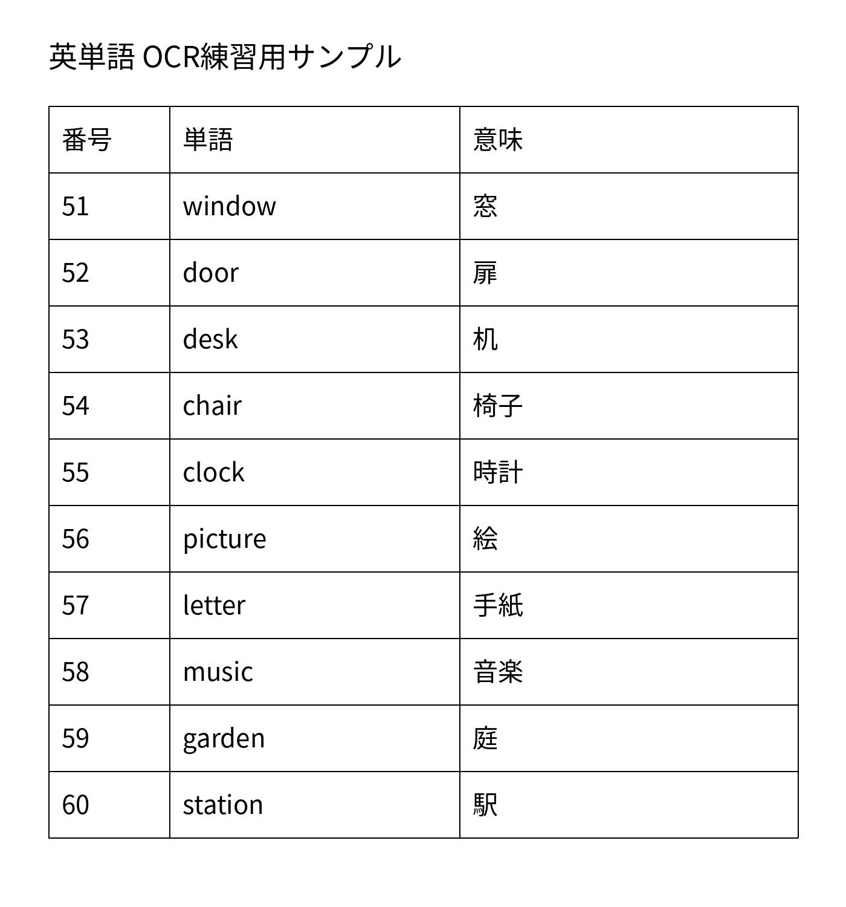

# OCR練習用サンプル

[OCR練習画像（JPEG）](ocr-sample-en.jpg)を開き、画像を保存してください。GitHubでは画像ページの「Raw」またはダウンロード操作から取得できます。デモの紹介時には、共有ログインID・パスワードとともに、このREADMEへのリンクを案内します。



## 既存のOCR画面で使う

1. デモへログインし、「デモ英単語50」を選択してOCR画面を開きます。
2. 保存した `ocr-sample-en.jpg` をアップロードして読み取ります。
3. 番号・単語・意味を画像と照合し、必要な箇所を編集して保存します。
4. 単語帳で51〜60番が追加されたことを確認します。追加後はその範囲で出題・PDF作成も試せます。

原稿は初期投入の1〜50番と重ならない10語です。既に他の利用者が51〜60番を追加している場合は、現在の帳内の番号を確認し、重複しない番号へ編集してから保存してください。デモは同じインスタンスの共有データで、編集・追加・削除は他の利用者にも見えます。インスタンスの再生成などで変更が失われることがあります。個人情報や機密情報は入力しないでください。

## 原稿と再生成

原稿は [`../../demo/data/samples.json`](../../demo/data/samples.json) の `ocr_samples`、公開由来は[原稿README](../../demo/data/README.md)に記載しています。画像はこの原稿から描画したもので、実在する教材の画像ではありません。実行時の画像生成は不要です。

Pillow（既存のPython依存）と日本語対応フォントを使って再生成できます。フォントはリポジトリに同梱しません。Dockerfileで導入している `fonts-noto-cjk` の例：

```sh
python scripts/render_demo_ocr_sample.py \
  --font /usr/share/fonts/opentype/noto/NotoSansCJK-Regular.ttc \
  --output docs/demo-samples/ocr-sample-en.jpg
```

Windowsでの例（Yu Gothicがインストールされている場合）：

```powershell
python scripts/render_demo_ocr_sample.py --font C:\Windows\Fonts\YuGothR.ttc --output docs/demo-samples/ocr-sample-en.jpg
```

フォントによって文字の形やJPEGのバイト列は変わり得ます。生成後は日本語が欠けていないことと、原稿の番号・単語・意味を目視確認してください。自動テストは外部API応答を置換して既存の確認・編集・保存を検証します。実APIの認識精度はIssue #34、GitHub上の最終的な取得確認は画像のpush後に確認します。
