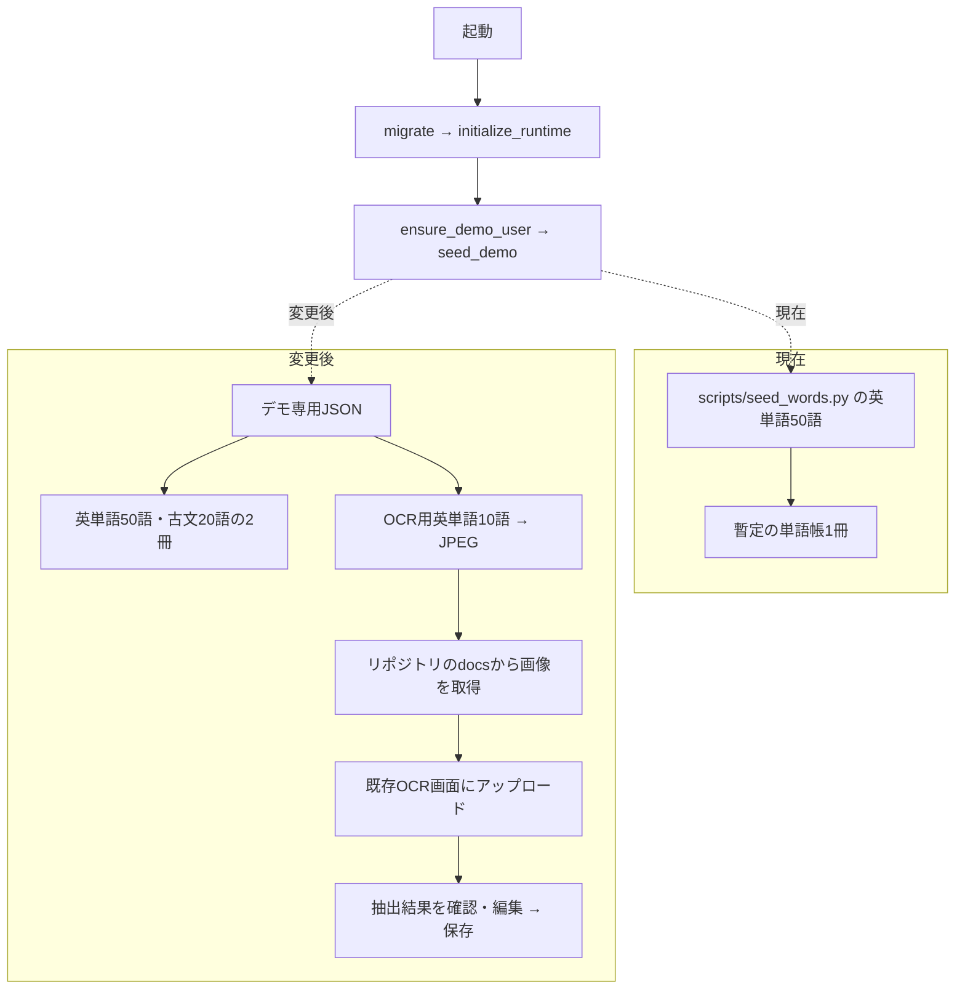
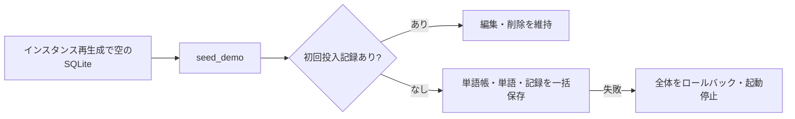

# Issue #30 公開デモ用サンプル Implementation Plan

> **For agentic workers:** REQUIRED SUB-SKILL: Use superpowers:executing-plans to implement this plan task-by-task. Steps use checkbox (`- [x]`) syntax for tracking.

**Goal:** 公開可能なサンプルで編集・OCR・出題・PDFを体験でき、同じDBでの再投入と新しいDBへの再生成を再現できるようにする。

**Architecture:** #29 の起動処理、初回投入記録、トランザクションを維持し、暫定の開発用50語への依存をデモ専用JSONへ置き換える。OCR用画像と照合用データを同じJSONから生成する。既存の認証・編集・OCR・テスト生成フローを利用する。

**Tech Stack:** Django、SQLite、Python、Pillow（既存依存）、既存TypeScript UI、WeasyPrint。

**Spec:** [Issue #30](https://github.com/magu1436/TestCreator/issues/30)、[公開デモ仕様書](https://docs.google.com/document/d/1ZziDbjLtnwCEcHECjoDa0XChiCCFmQQpeR4HQblHsH4/edit) 第2〜5、7、9〜10節。

## 要求と設計判断

- Issue明記：公開可能なサンプル、編集・OCR結果保存・出題の体験、Git管理による再現、重複防止、共有・揮発性、本番データ非依存。
- コード確認済み：`seed_demo` は `scripts.seed_words.WORDS` の英単語50語を1冊に投入。`initial-samples` 記録と投入は同一トランザクション。同じDBへの再実行では、削除された単語帳も復元しない。
- 計画上の判断（利用者が指定した件数ではない）：英単語50語・古文単語20語の2冊。英語は基本語彙、古文は短い自作文義とし、教材の配列・説明・画像を転載しない。OCR用に未投入の英単語10語（51〜60番）を用意し、英語帳へ追記できるようにする。
- ユーザー指定：プロダクトへの変更は最小限にする。OCR画面にダウンロードリンクや案内を追加しない。画像は `docs/demo-samples/ocr-sample-en.jpg` に置き、同ディレクトリのREADMEと `docs/demo.md` から取得方法を案内する。デモ紹介時に、共有ログインID・パスワードと同様に、このリポジトリ上の素材の取得先を利用者へ勧める。

## Global Constraints

- `DEMO_MODE=true` の場合だけサンプル投入とデモ用案内を有効にする。
- #30ではOCR画面・テンプレート・フロントエンドに変更を加えない。素材配布はリポジトリの `docs` 配下で完結させる。サンプル投入に必要な変更は既存のデモ専用処理へ限定する。
- 本番Cloud Run `wordtest`、本番TiDB、実利用者・実OCR履歴は使用しない。
- 通常のDjangoログインを維持し、共有ユーザーにstaff/superuser権限を付与しない。
- 同じSQLiteファイルでは利用者の編集・削除を維持する。サンプルの変更や再起動だけで強制復元しない。
- 新しいインスタンスの空SQLiteではサンプルを復元する。定期リセットやインスタンス間のデータ共有は保証しない。
- Cloud Run設定・公開デプロイは#31/#32、OCR制限・戻り値の整合修正は#33、実環境E2Eは#34。
- ユーザーの実装指示により、以下を実装・検証しローカルコミットする。push・PR作成・Issueへの書き込みは行わない。

## 現在と変更後

## 完了条件と確認方法

| 番号 | 完了条件 | 根拠 | 確認方法 |
| --- | --- | --- | --- |
| 1 | 公開可能な英語・古文サンプルとOCR用素材がある | Issue要求、件数・構成は設計判断 | 原稿・権利説明の目視確認、JSONの件数・文字数・番号検証、JPEGの日本語表示確認 |
| 2 | 初期データで編集・追加・削除、範囲移動、ランダム、両方向の出題、プレビュー・問題/解答PDFが使える | Issue要求 | サンプル投入後の統合テストとブラウザ手動確認。範囲1〜10→11〜20、ランダム10問、両方向の語義とPDFを照合 |
| 3 | リポジトリのdocsからOCR画像を取得し、既存画面で抽出結果を確認・編集して保存できる | Issue要求、配布方法はユーザー指定 | READMEの取得手順と画像への相対リンクの照合、外部API境界のみ置換した保存テスト。実APIでの画像認識は#34へ引き継ぐ |
| 4 | Git管理された素材から本番に依存せず再現できる | Issue要求 | 隔離SQLiteでmigrate→initialize_runtime。JPEG再生成時の表内容をJSONと照合 |
| 5 | 同一DBの再投入で重複せず編集・削除を維持し、空の新DBでは初期状態へ戻る | Issue要求、復元タイミングは仕様書・#29 | 既存ファイルDBテストを2冊70語へ更新。全削除後の再実行、失敗時ロールバック、別ファイルDBで復元を確認 |
| 6 | 他の利用者にも編集が見え、消失し得る案内と一致する | Issue要求 | 同じ共有ユーザーでログインした2クライアント間の反映と案内表示を確認。別インスタンス間共有は対象外 |
| 7 | 通常環境にはサンプル投入が混入せず、既存のOCR画面・導線を維持する | 共通制約・ユーザー指定 | 既存の通常モード拒否テスト維持、変更差分でOCRテンプレート・フロントエンドを変更していないことを確認 |

## Review Focus

- 単語帳・単語を全削除してから再実行しても復元しない：Task 1の投入記録テスト。
- 2冊目の投入途中で失敗しても1冊目と投入記録を残さない：Task 1のトランザクションテスト。
- OCR用の番号が初期英語50語と衝突しない：Task 2の51〜60番検証。
- 日本語フォント不足で読めない画像を配布しない：Task 2でフォント明示とJPEG目視確認。
- 共有アカウントの別セッションと、独立インスタンスのDBを混同しない：Task 3で2クライアント確認と運用手順に明記。

## Task 1: 専用サンプルと投入処理

**Files:** 新規 `demo/data/samples.json`、`demo/data/README.md`、変更 `accounts/management/commands/seed_demo.py`、`TestCreator/test_demo_initialization.py`。

**Interfaces:** JSONルートに `wordlists`（`name`, `words`）、`ocr_samples`（`target_wordlist_name`, `words`）を持つ。各wordは `number: int`, `term: str`, `meaning: str`。公開用JSONは実アカウント・DBのPK・パスワード・OCRログを含まない。`seed_demo` コマンド名と `initial-samples` キーを維持する。

- [x] 2冊70語・ユーザー帰属・全削除後の再実行・2冊目での失敗時ロールバックを検証するテストへ更新する。
- [x] `python manage.py test TestCreator.test_demo_initialization --settings=TestCreator.demo_test_settings --noinput` を実行し、暫定1冊50語との差による失敗を確認する。
- [x] 公開用の原稿を作成し、由来・自作文義・非転載方針をREADMEへ記載する。名前30文字以内、term30文字以内、meaning100文字以内、各帳内の正整数番号重複なしを確認する。
- [x] `seed_demo` の入力を専用JSONへ変更する。1回の `transaction.atomic()` で全帳・全語・完了記録を保存し、開発用 `scripts/seed_words.py` は変更しない。
- [x] 上記テストの成功を確認し、この単位でコミットする。

## Task 2: OCR体験用素材

**Files:** 新規 `scripts/render_demo_ocr_sample.py`、`docs/demo-samples/ocr-sample-en.jpg`、`docs/demo-samples/README.md`、`TestCreator/test_demo_samples.py`。

**Interfaces:** Task 1の `ocr_samples` を利用。生成CLIは `python scripts/render_demo_ocr_sample.py --font <日本語フォントパス> --output docs/demo-samples/ocr-sample-en.jpg`。Pillowで番号・単語・日本語訳の10行を描画。フォントは同梱せず、利用可能な日本語フォントを明示する。画像はGit管理し、実行時生成は不要。READMEには画像の表示・ダウンロード、英語帳への保存手順、共有データである旨を記載する。

- [x] JSONの51〜60番・10語・初期英語帳と番号非重複、OCR結果を既存英語帳へ追記できるテストを追加する。抽出結果は既存同様に外部API応答境界だけ置換する。
- [x] `python manage.py test TestCreator.test_demo_samples TestCreator.test_demo --settings=TestCreator.demo_test_settings --noinput` で変更前の失敗を確認する。
- [x] 生成CLIを実装し、JPEGと取得・利用手順のREADMEを `docs/demo-samples` に用意する。OCR画面・静的配信設定は変更しない。
- [x] 上記テスト成功と、画像の番号・語義・日本語の目視照合、READMEの画像リンクと取得手順を確認してコミットする。API認識精度は自動テストの置換応答では証明できないため、#34の実OCR検証へ渡す。GitHubでの最終的な取得確認は画像のpush後に行う。

## Task 3: 体験・共有・再生成の検証と手順

**Files:** 変更 `TestCreator/test_demo_samples.py`、`TestCreator/test_demo_initialization.py`、`docs/demo.md`。

**Interfaces:** Task 1の初期2冊70語とTask 2のOCR素材を使用。既存 `initialize_runtime` / `ensure_demo_user` / `seed_demo` と既存UI/APIを呼び出す。

- [x] サンプルを投入した状態から、別クライアントへの編集反映、番号範囲、ランダム10問、両出題方向、プレビュー・実PDFの内容を検証する。乱数の特定順序に依存せず、件数・範囲内・重複なしを照合する。
- [x] ファイルDBテストを初期70語→1語編集・1語削除→同一ファイルで69語維持→別の空ファイルで2冊70語復元へ更新する。セッションとOCRログが新DBで空になる既存確認も維持する。
- [x] `python manage.py test --settings=TestCreator.demo_test_settings --noinput` を実行し全件成功を確認する。実施時は必要なPython・日本語PDF用ネイティブライブラリのある環境を利用する。
- [ ] ブラウザで範囲移動1〜10→11〜20、単語帳切替、両出題方向、リポジトリdocsからのJPEG取得→既存OCR画面へのアップロード→結果の確認・編集・保存、PDFを確認する。外部API実行の有無と未確認項目を分けて記録する。
- [x] `docs/demo.md` の暫定説明を置換し、データ構成、`demo-samples/README.md` への相対リンク、OCR素材生成方法、同一DBへの再実行と空DBへの再生成の違い、ローカルの隔離検証手順を記載する。素材取得先はログイン資格情報と合わせてデモ紹介時に案内する方針を明記する。既存DBを削除する汎用リセットコマンドは追加しない。Cloud Run実地再生成は#34へ渡す。
- [x] 検証結果を記録してコミットする。

## 着手準備の記録（2026-11-19）

- 対象リポジトリ：`magu1436/TestCreator`。
- コーディング：伴う。着手準備時点では計画のみ作成。
- Projects：WordTestCreatorKanban の `In progress` → `In progress`（既に着手中のため変更なし）。
- ブランチ：`codex/30-demo-sample-data`。`gh issue develop 30 --base develop --name codex/30-demo-sample-data --checkout` で作成。
- 起点：`origin/develop` の `eee385090b491bd0553ac60e81246ff76d2f55c4`（#29マージ済み）。
- push先：`origin/codex/30-demo-sample-data`。同SHAを確認。`gh issue develop 30 --list` でIssue紐づけ確認済み。
- 準備結果：完了。未解決の必須確認事項なし。サンプル件数は計画上の設計判断。OCR画面を変更せずdocsから素材を配布する方針はユーザー指定。
- 着手準備時点の検証：Issue・正本仕様書・既存コード・Git状態の照合まで。実装後の確認結果は次節に記載する。

## 実装・検証記録（2026-11-19）

- ユーザーの実装指示を受け、Task 1〜3の実装を完了。既存画面・認証・OCR処理・出題処理は変更していない。実行時コードの変更はデモ専用 `seed_demo` の入力差し替えのみ。
- テストは既存の配置と自動発見に合わせ、`demo/test_samples.py` ではなく `TestCreator/test_demo_samples.py` に集約した。
- Task 1：変更前に7件中3件の期待した失敗を確認し、実装後7件成功。親側でも7件を再実行して成功。初期70語と原稿一致・ユーザー帰属、再投入69語維持、全削除維持、2冊目失敗時の全体ロールバック、新ファイルDB復元を確認した。
- Task 2：CLI/画像がない状態での失敗を確認し、追加後11件成功。親側でも11件を再実行して成功。JPEGは1400×1500、番号51〜60の10語と日本語を原稿と目視照合した。OCR統合では外部API応答境界だけ置換し、抽出後の訳の編集と10語保存を確認した。
- Task 3：同一共有ユーザーの別セッションに編集が反映されること、範囲の切替、範囲内のランダム10問・重複なし、2冊×両方向のプレビューと実PDFを確認した。全体テスト56件成功、追加したファイルDB照合2件も成功。
- ブラウザ：隔離コンテナへ通常ログインし、2冊の選択、1〜10→11〜20の範囲移動、英語の意味→単語・ランダムプレビュー、古文の単語→意味・番号順プレビューを確認。古文20問の作成操作から、実PDF2ページと日本語「あはれなり」の出力を確認した。
- 実コンテナ：同じコンテナで1語編集・1語削除後に `initialize_runtime` を再実行し、編集と69語を維持。ネットワーク無効の別の新規コンテナで `migrate` → `initialize_runtime` を実行し、2冊70語と初期のappleを復元した。
- リポジトリのDockerfileで `testcreator:issue30-review` のビルド成功。最終テスト・手順書がイメージ内と一致することをSHA256で照合した。
- 親の最終確認：新イメージを `--network none` で起動し、`python manage.py test --settings=TestCreator.demo_test_settings --noinput` は56件成功（35.082秒、スキップなし）。
- ブラウザ確認のチェックが未完了なのは、実APIを使う画像の認識・確認編集保存を今回実施していないため。保存処理は統合テストで確認済み。実APIでの画像認識、公開Cloud Runでの再生成・E2Eは当初の分担どおり#34へ引き継ぐ。GitHub上の画像取得確認はpush後に行う。
- ローカルコミット：`5017399`（専用サンプル投入）、`7d4761f`（OCR素材）。Task 3・計画記録は最終確認後に別コミットとする。
